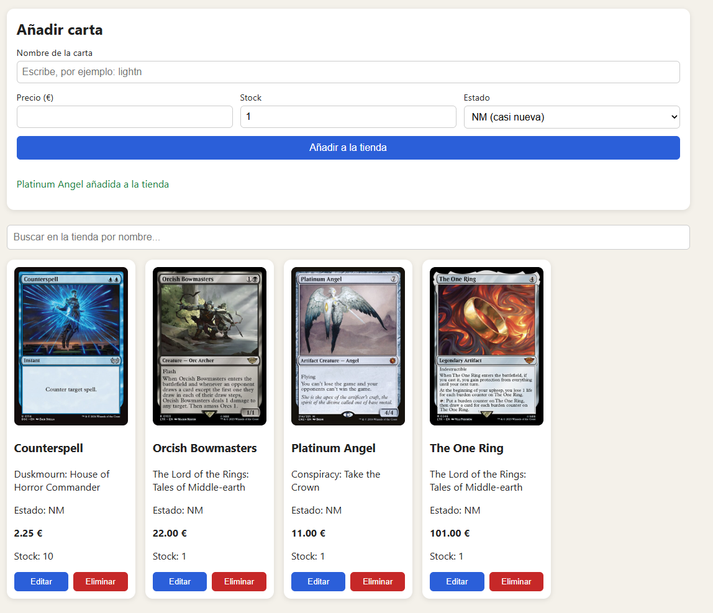

# Magic Card Store

[](https://github.com/JavierMoyaSimo/magic-card-store/actions/workflows/ci.yml)

Una aplicación web full-stack para gestionar una tienda online de cartas de _Magic: The Gathering_, inspirada en CardMarket. Escribe el nombre de una carta o sube una fotografía de ella y la aplicación obtiene automáticamente sus datos e imagen oficiales.



## Funcionalidades

- Añadir cartas a la tienda por nombre, con sugerencias de autocompletado mientras escribes.
- **Añadir cartas mediante una fotografía**: la API de Claude (visión) identifica el nombre de la carta y Scryfall proporciona sus datos oficiales.
- Obtener automáticamente los datos e imágenes de las cartas mediante la [API de Scryfall](https://scryfall.com/docs/api).
- Búsqueda tolerante a errores tipográficos: por ejemplo, "light bolt" encuentra _Lightning Bolt_.
- Datos específicos de cada carta en la tienda: precio, stock y estado de conservación (NM, LP, MP, HP, DMG).
- Buscar cartas en la tienda por nombre.
- Editar el precio, el stock y el estado de conservación, así como eliminar cartas.
- Protección contra duplicados: no se puede añadir dos veces la misma carta.
- Pruebas automatizadas e integración continua mediante GitHub Actions.

## Cómo funciona la identificación mediante fotografías

1. El navegador envía la fotografía al backend (nunca directamente a la API de IA, para mantener privada la clave de acceso).
2. El backend valida el archivo (únicamente imágenes, con un tamaño máximo de 5 MB) y lo envía a Claude junto con una instrucción para obtener exclusivamente el nombre de la carta en formato JSON.
3. El nombre devuelto se consulta en Scryfall para obtener los datos oficiales de la carta.
4. El formulario se completa automáticamente y el usuario **revisa el resultado** antes de guardarlo, ya que el reconocimiento mediante IA puede cometer errores.

## Tecnologías utilizadas

| Capa                           | Tecnología                                                          |
| ------------------------------ | ------------------------------------------------------------------- |
| Frontend                       | React, Vite                                                         |
| Backend                        | Node.js, Express, Multer                                            |
| Base de datos                  | MongoDB Atlas, Mongoose                                             |
| APIs externas                  | Scryfall (datos de cartas), Claude API (reconocimiento de imágenes) |
| Pruebas e integración continua | `node:test`, Supertest, GitHub Actions                              |

## Estructura del proyecto

```text
magic-card-store/
├── .github/workflows/   # Flujo de integración continua (CI)
├── backend/
│   ├── src/
│   │   ├── models/      # Esquemas de Mongoose (Card)
│   │   ├── services/    # Clientes de las APIs de Scryfall y Claude
│   │   ├── routes/      # Rutas de Express
│   │   ├── app.js       # Aplicación Express (middlewares y rutas)
│   │   └── index.js     # Punto de entrada del servidor (conexión a la base de datos)
│   └── tests/           # Pruebas de la API
├── frontend/
│   └── src/
│       ├── components/  # AddCardForm, CardList, CardItem
│       └── App.jsx
└── docs/
```

## Endpoints de la API

| Método | Endpoint                        | Descripción                                                                          |
| ------ | ------------------------------- | ------------------------------------------------------------------------------------ |
| GET    | `/api/health`                   | Comprobar el estado del servidor                                                     |
| GET    | `/api/scryfall/autocomplete?q=` | Obtener sugerencias de nombres de cartas                                             |
| GET    | `/api/scryfall/search?name=`    | Buscar una carta por nombre (búsqueda aproximada)                                    |
| POST   | `/api/identify`                 | Identificar una carta mediante una fotografía (`multipart/form-data`, campo `image`) |
| GET    | `/api/cards?search=`            | Obtener las cartas de la tienda, con filtro opcional por nombre                      |
| GET    | `/api/cards/:id`                | Obtener una carta concreta                                                           |
| POST   | `/api/cards`                    | Añadir una carta (`name`, `price`, `stock`, `condition`)                             |
| PUT    | `/api/cards/:id`                | Actualizar el `price`, `stock` o `condition`                                         |
| DELETE | `/api/cards/:id`                | Eliminar una carta                                                                   |

## Puesta en marcha

### Requisitos previos

- [Node.js](https://nodejs.org/) (versión LTS).
- Un clúster gratuito de [MongoDB Atlas](https://www.mongodb.com/cloud/atlas), con un usuario de base de datos creado y tu dirección IP autorizada en _Network Access_.
- Una clave API de Anthropic, disponible en [Claude Console](https://platform.claude.com/) (solo necesaria para la funcionalidad de identificación mediante fotografías).

### Instalación

```bash
git clone https://github.com/JavierMoyaSimo/magic-card-store.git
cd magic-card-store
npm install
npm run install:all
cp backend/.env.example backend/.env   # Después, edita backend/.env con tus propios valores
npm run dev
```

La API estará disponible en `http://localhost:5000` y la aplicación en `http://localhost:5173`. Vite redirige las peticiones a `/api` hacia el backend.

### Variables de entorno

Definidas en `backend/.env`:

| Variable            | Descripción                                                                                        |
| ------------------- | -------------------------------------------------------------------------------------------------- |
| `MONGODB_URI`       | Cadena de conexión de MongoDB Atlas, incluyendo el nombre de la base de datos                      |
| `PORT`              | Puerto del backend (por defecto, `5000`)                                                           |
| `ANTHROPIC_API_KEY` | Clave API de Claude, utilizada para la funcionalidad de identificación mediante fotografías        |
| `CLAUDE_MODEL`      | Opcional. Modelo de Claude utilizado para identificar las cartas (por defecto, `claude-haiku-5-5`) |

### Ejecución de las pruebas

```bash
npm test
```

Las pruebas comprueban las validaciones de la API y no necesitan una base de datos ni claves API. También se ejecutan automáticamente en cada `push` mediante GitHub Actions.

## Solución de problemas

- **Error `querySrv ECONNREFUSED` al conectar con MongoDB**: algunas redes bloquean las consultas DNS SRV utilizadas por las URL `mongodb+srv://`. El backend configura servidores DNS públicos (Google y Cloudflare) en `src/index.js` para solucionar este problema.
- **Tiempo de espera de conexión agotado**: comprueba que tu dirección IP actual esté autorizada en Atlas, dentro de _Network Access_.
- **La identificación mediante fotografías falla con un error de autenticación**: comprueba que `ANTHROPIC_API_KEY` esté configurada en `backend/.env` y reinicia el backend.

## Próximas mejoras

- [x] Añadir cartas subiendo una fotografía, utilizando la API de Claude con capacidad de visión.
- [x] Pruebas automatizadas e integración continua.
- [ ] Cuentas de usuario y autenticación (también necesarias para proteger el endpoint de pago de identificación mediante fotografías).
- [ ] Limitación de solicitudes (Rate limiting).
- [ ] Carrito de compra y gestión de pedidos.
- [ ] Despliegue de la aplicación.

## Créditos

Los datos e imágenes de las cartas son proporcionados por [Scryfall](https://scryfall.com). _Magic: The Gathering_ es una marca registrada de Wizards of the Coast. Este es un proyecto de fans no oficial y no está afiliado ni cuenta con el respaldo de Wizards of the Coast o Scryfall.

## Licencia

MIT
