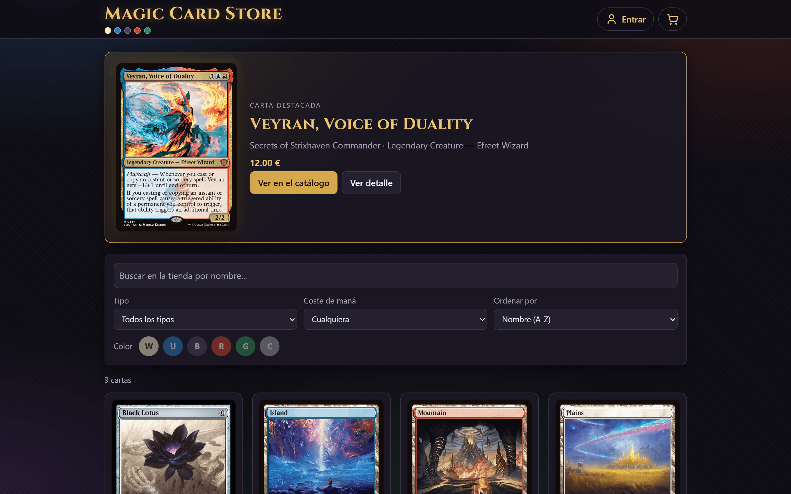
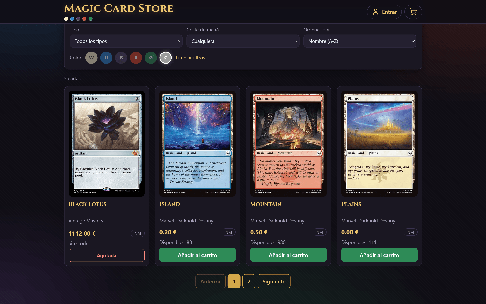
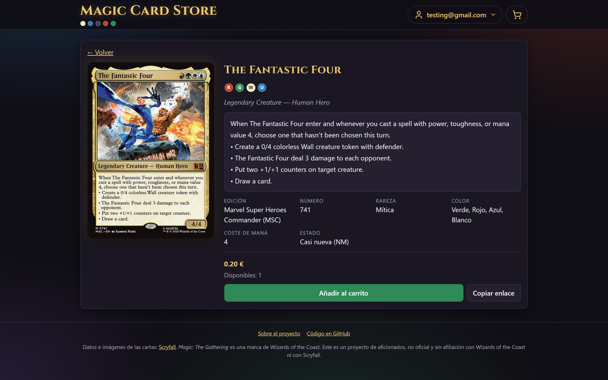
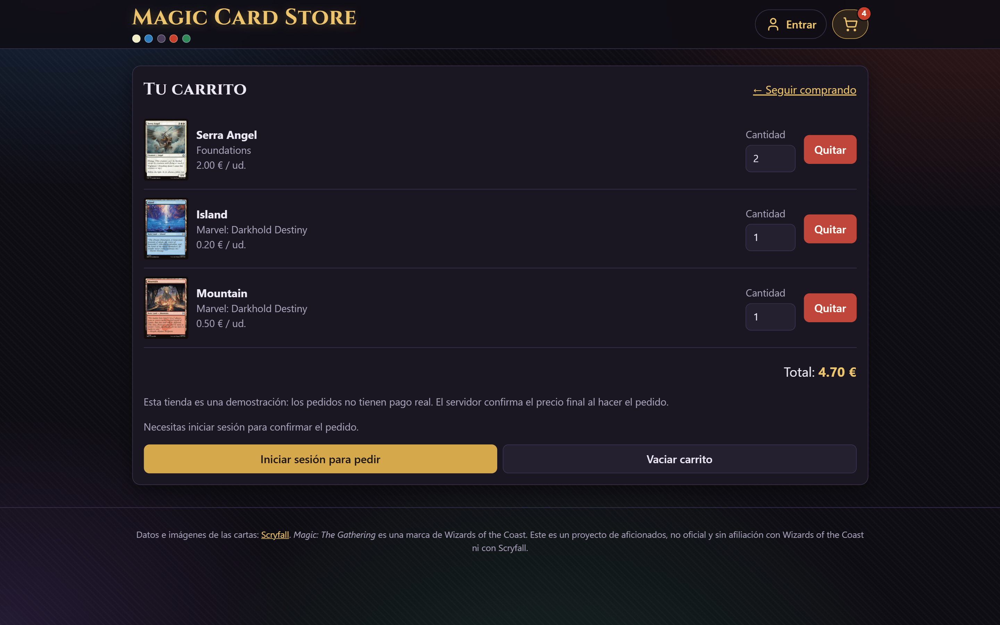
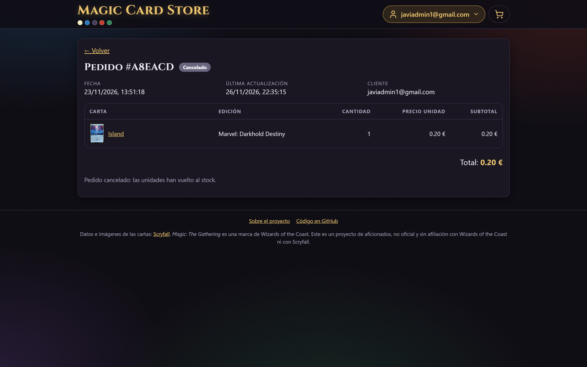
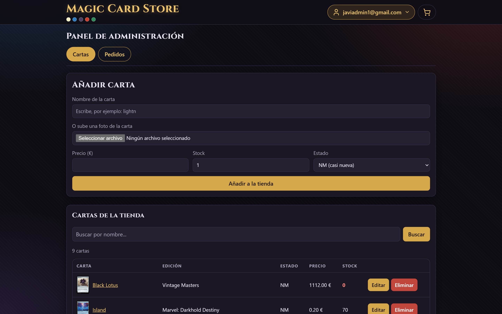
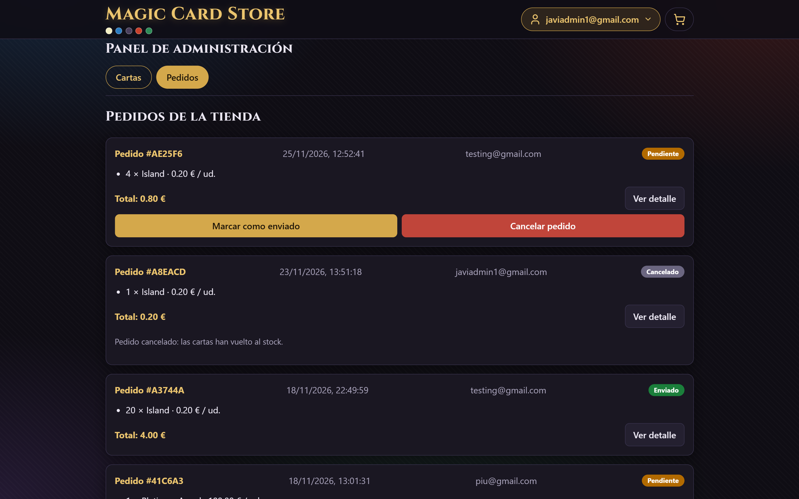
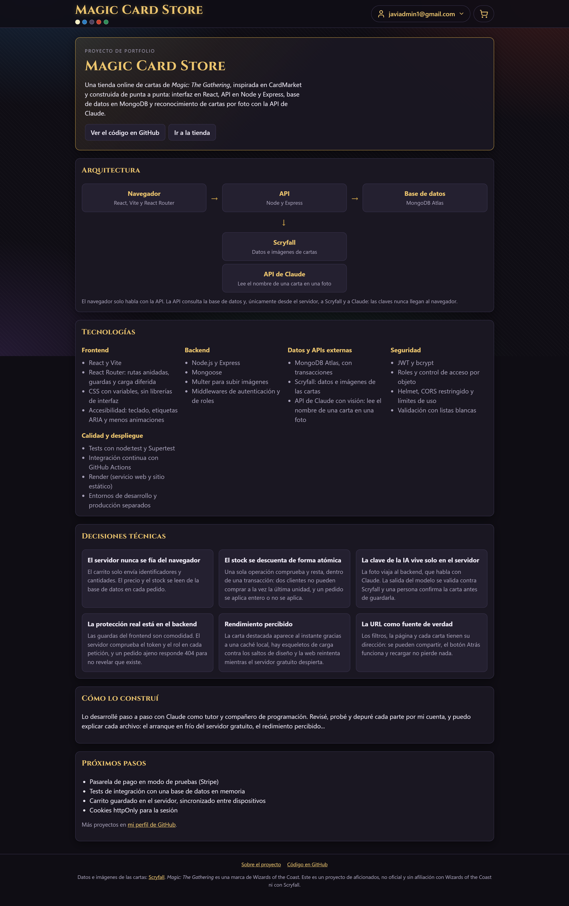
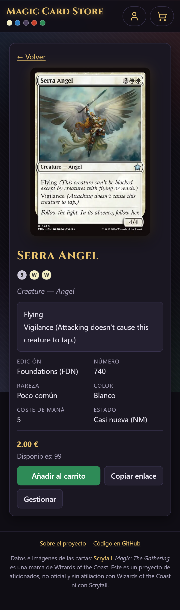

# Magic Card Store

[](https://github.com/JavierMoyaSimo/magic-card-store/actions/workflows/ci.yml)

Una aplicación web full-stack para gestionar una tienda online de cartas de _Magic: The Gathering_, inspirada en CardMarket. Escribe el nombre de una carta o sube una fotografía de ella y la aplicación obtiene automáticamente sus datos e imagen oficiales.

## Demo en vivo

**https://magic-card-store-1.onrender.com**

El catálogo es público y se puede consultar sin iniciar sesión. Para probar el resto de funcionalidades, puedes crear una cuenta de cliente desde la propia web.

> La aplicación está alojada en el plan gratuito de Render: si nadie la ha usado en los últimos 15 minutos, el servidor se duerme y la primera carga puede tardar alrededor de un minuto en responder.

## Capturas de pantalla

### Catálogo



### Filtros y paginación



### Ficha de una carta



### Carrito y pedidos





### Panel de administración





### Sobre el proyecto



### Móvil

<p align="center">
  
</p>

## Funcionalidades

### Catálogo y compra

- Catálogo público: cualquier visitante puede consultar y buscar las cartas de la tienda por nombre. Las herramientas de gestión no aparecen en la tienda: los administradores la ven igual que un cliente.
- Filtros por tipo de carta, color de maná y coste de maná, con ordenación y paginación. Los filtros se guardan en la dirección web, por lo que se pueden compartir.
- Ficha de cada carta (`/cartas/:id`) con texto de reglas, edición, rareza, color y coste de maná, con los símbolos de maná dibujados con CSS. Se puede copiar su enlace y añadirla al carrito desde ella.
- Sección de carta destacada: una carta al azar con stock, mostrada con su imagen completa y sin modificar.
- Carrito de compra guardado en el navegador, con el stock disponible calculado a partir de lo que ya llevas en él.
- Pedidos sin pago real: el servidor calcula los precios, comprueba el stock y descuenta las unidades de forma atómica dentro de una transacción.
- Historial de pedidos y página de detalle de cada pedido (`/pedidos/:id`), con sus líneas, subtotales, total y estado. El pedido solo lo puede ver su dueño o un administrador.

### Administración

- Panel de administración (`/admin`) con rutas anidadas y dos pestañas: cartas y pedidos.
- Gestión de cartas en una tabla con buscador y paginación (guardados en la dirección web): añadir cartas, editar el precio, el stock y el estado de conservación (NM, LP, MP, HP, DMG) en la propia fila, y eliminarlas.
- Añadir cartas a la tienda por nombre, con sugerencias de autocompletado mientras escribes.
- **Añadir cartas mediante una fotografía**: la API de Claude (visión) identifica el nombre de la carta y Scryfall proporciona sus datos oficiales.
- Obtener automáticamente los datos e imágenes de las cartas mediante la [API de Scryfall](https://scryfall.com/docs/api), con búsqueda tolerante a errores tipográficos (por ejemplo, "light bolt" encuentra _Lightning Bolt_).
- Protección contra duplicados: no se puede añadir dos veces la misma carta.
- Panel de pedidos de la tienda: el administrador puede marcarlos como enviados o cancelarlos (al cancelar, el stock se devuelve a la tienda).

### Cuentas y seguridad

- Cuentas de usuario con registro e inicio de sesión (autenticación con JWT y contraseñas cifradas con bcrypt).
- Control de acceso por roles: solo los administradores pueden gestionar las cartas y usar las funciones que consultan APIs externas.
- Limitación de intentos (_rate limiting_) en los endpoints de registro e inicio de sesión.
- Cabeceras HTTP de protección con Helmet y límite de uso por usuario en la identificación mediante fotografías, que consume saldo de la API de Claude.

### Experiencia de usuario

- Enrutado con React Router: cada pantalla tiene su propia dirección (el botón Atrás funciona y se puede enlazar cualquier página), con diseño común, rutas anidadas, rutas protegidas por sesión y por rol, y página 404.
- Diseño propio con tema oscuro de inspiración fantástica, construido con variables CSS y adaptado a móvil.
- Cabecera fija estilo tienda online: icono de carrito con contador, menú de cuenta desplegable (con acceso al panel para los administradores) y aviso al añadir una carta al carrito.
- Ventana modal de acceso construida con el elemento nativo `<dialog>` (foco atrapado y cierre con Escape).
- Accesibilidad: navegación por teclado, enlace para saltar al contenido, etiquetas ARIA en los controles y respeto a la preferencia de menos animaciones.
- Reintentos automáticos con espera creciente solo en las peticiones de lectura (GET), para evitar duplicar operaciones que modifican datos, como un pedido. Mientras el servidor gratuito despierta, la web avisa al usuario.
- Página «Sobre el proyecto» (`/proyecto`) con la arquitectura, las tecnologías y las decisiones técnicas.
- Carga diferida de rutas (`React.lazy` y `Suspense`): las páginas poco visitadas, como el panel de administración, solo se descargan cuando se usan. Un límite de error (`ErrorBoundary`) protege el caso de que una página diferida no consiga descargarse, por ejemplo tras un despliegue nuevo.

### Calidad y despliegue

- Pruebas automatizadas e integración continua mediante GitHub Actions.
- Aplicación desplegada en internet (frontend y backend en Render, base de datos en MongoDB Atlas).

## Autenticación y roles

- Los usuarios se registran con email y contraseña. De la contraseña solo se guarda un hash generado con bcrypt, nunca el texto original.
- Al iniciar sesión, el servidor devuelve un JWT firmado que caduca a los 7 días. La web lo envía en la cabecera `Authorization: Bearer <token>`.
- Existen dos roles: `customer` (el que recibe cualquier cuenta nueva) y `admin`. El rol **no se puede elegir al registrarse**: la única forma de crear un administrador es el script `make-admin`, que se ejecuta en el servidor.
- Las rutas protegidas pasan por dos middlewares: `requireAuth` (responde `401` si no hay una sesión válida) y `requireAdmin` (responde `403` si el usuario no es administrador).
- Los endpoints de registro e inicio de sesión permiten un máximo de 30 intentos cada 15 minutos por dirección IP.

## Cómo funciona la identificación mediante fotografías

1. El administrador sube la fotografía desde el navegador al backend (nunca directamente a la API de IA, para mantener privada la clave de acceso).
2. El backend comprueba la sesión y el rol, valida el archivo (únicamente imágenes, con un tamaño máximo de 5 MB) y lo envía a Claude junto con una instrucción para obtener exclusivamente el nombre de la carta en formato JSON.
3. El nombre devuelto se consulta en Scryfall para obtener los datos oficiales de la carta.
4. El formulario se completa automáticamente y el usuario **revisa el resultado** antes de guardarlo, ya que el reconocimiento mediante IA puede cometer errores.

## Pedidos y gestión del stock

1. El carrito vive en el navegador (`localStorage`) y solo envía al servidor identificadores de cartas y cantidades.
2. Al confirmar, el backend **ignora cualquier precio enviado por la web**: lee el precio y el stock reales de cada carta en la base de datos.
3. El descuento de stock se hace con una operación atómica (`findOneAndUpdate` con la condición `stock >= cantidad` y un `$inc`), para que dos clientes no puedan comprar a la vez la última unidad.
4. Todas las operaciones de un pedido se ejecutan dentro de una **transacción de MongoDB**: o se aplican todas o ninguna.
5. El pedido guarda una copia del nombre y del precio de cada carta en el momento de la compra, de modo que el historial no cambia si luego se edita o se borra la carta.
6. Estados del pedido: `pending`, `shipped` y `cancelled`. Solo se puede cambiar un pedido pendiente, y cancelarlo devuelve las unidades al stock.

Esta versión es una demostración: no hay pasarela de pago ni dirección de envío.

## Tecnologías utilizadas

| Capa                           | Tecnología                                                                            |
| ------------------------------ | ------------------------------------------------------------------------------------- |
| Frontend                       | React, Vite, React Router                                                             |
| Backend                        | Node.js, Express, Multer                                                              |
| Base de datos                  | MongoDB Atlas, Mongoose                                                               |
| Autenticación y seguridad      | JSON Web Tokens (`jsonwebtoken`), bcrypt (`bcryptjs`), `express-rate-limit`, `helmet` |
| APIs externas                  | Scryfall (datos de cartas), Claude API (reconocimiento de imágenes)                   |
| Pruebas e integración continua | `node:test`, Supertest, GitHub Actions                                                |
| Despliegue                     | Render (Web Service y Static Site), MongoDB Atlas                                     |

## Estructura del proyecto

```text
magic-card-store/
├── .github/workflows/   # Flujo de integración continua (CI)
├── backend/
│   ├── src/
│   │   ├── middleware/  # Autenticación y control de roles (requireAuth, requireAdmin)
│   │   ├── models/      # Esquemas de Mongoose (Card, User, Order)
│   │   ├── routes/      # Rutas de Express (cartas, Scryfall, identificación, autenticación, pedidos)
│   │   ├── services/    # Clientes de las APIs de Scryfall y Claude
│   │   ├── utils/       # Traducción de filtros a consultas de MongoDB (cardQuery.js) y control de acceso de pedidos(orderAccess.js)
│   │   ├── scripts/     # Scripts de administración (make-admin, backfill)
│   │   ├── app.js       # Aplicación Express (middlewares, CORS y rutas)
│   │   └── index.js     # Punto de entrada del servidor (conexión a la base de datos)
│   └── tests/           # Pruebas de la API y del traductor de filtros
├── frontend/
│   ├── index.html       # Página base (título, tipografía y favicon)
│   ├── vite.config.js   # Configuración de Vite (proxy de /api en desarrollo)
│   └── src/
│       ├── auth/        # Contexto de autenticación (AuthProvider, useAuth)
│       ├── cart/        # Contexto del carrito (CartProvider, useCart)
│       ├── components/  # Piezas de interfaz: AccountMenu, AddCardForm, AdminCardRow, AuthPanel,
│       │                # CardItem, CardList, CartToast, CartView, FeaturedCard, FilterBar,
│       │                # Icons, ManaText, OrdersView, Pagination, SiteHeader, ErrorBoundary, PageFallback
│       ├── hooks/       # Hooks propios (useCatalogFilters, usePageTitle)
│       ├── layout/      # Diseños con <Outlet />: Layout (cabecera y pie) y AdminLayout (pestañas)
│       ├── pages/       # Una página por ruta: CatalogPage, CardPage, CartPage, OrdersPage, OrderDetailPage
│       │                # AdminCardsPage, AdminOrdersPage, NotFoundPage, AboutPage
│       ├── routes/      # Guardas de rutas: RequireAuth y RequireAdmin
│       ├── api.js       # URL de la API (VITE_API_URL) y fetch con reintentos
│       ├── filters.js   # Opciones de filtros y conversión desde y hacia la dirección web
│       ├── orders.js    # Estados y número del pedido
│       ├── aboutData.js # Contenido de la página : "Sobre el proyecto"
│       ├── scroll.js    # Desplazamiento suave que respeta la preferencia de menos animaciones
│       ├── App.jsx      # Tabla de rutas
│       ├── main.jsx     # Punto de entrada de React (BrowserRouter y proveedores)
│       └── index.css    # Estilos y variables de diseño
└── docs/                # Capturas de pantalla
```

## Endpoints de la API

| Método | Endpoint                        | Acceso        | Descripción                                                                          |
| ------ | ------------------------------- | ------------- | ------------------------------------------------------------------------------------ |
| GET    | `/api/health`                   | Público       | Comprobar el estado del servidor                                                     |
| POST   | `/api/auth/register`            | Público       | Crear una cuenta de cliente (`email`, `password`)                                    |
| POST   | `/api/auth/login`               | Público       | Iniciar sesión y recibir un JWT                                                      |
| GET    | `/api/auth/me`                  | Sesión        | Obtener el usuario asociado al token                                                 |
| GET    | `/api/cards`                    | Público       | Obtener las cartas de la tienda con filtros, ordenación y paginación (ver más abajo) |
| GET    | `/api/cards/featured`           | Público       | Obtener una carta al azar que tenga stock e imagen                                   |
| GET    | `/api/cards/:id`                | Público       | Obtener una carta concreta                                                           |
| POST   | `/api/cards`                    | Administrador | Añadir una carta (`name`, `price`, `stock`, `condition`)                             |
| PUT    | `/api/cards/:id`                | Administrador | Actualizar el `price`, `stock` o `condition`                                         |
| DELETE | `/api/cards/:id`                | Administrador | Eliminar una carta                                                                   |
| GET    | `/api/scryfall/autocomplete?q=` | Administrador | Obtener sugerencias de nombres de cartas                                             |
| GET    | `/api/scryfall/search?name=`    | Administrador | Buscar una carta por nombre (búsqueda aproximada)                                    |
| POST   | `/api/identify`                 | Administrador | Identificar una carta mediante una fotografía (`multipart/form-data`, campo `image`) |
| POST   | `/api/orders`                   | Sesión        | Crear un pedido (`items`: lista de `cardId` y `quantity`)                            |
| GET    | `/api/orders/mine`              | Sesión        | Obtener los pedidos del usuario                                                      |
| GET    | `/api/orders`                   | Administrador | Obtener todos los pedidos                                                            |
| GET    | `/api/orders/:id`               | Sesión        | Obtener un pedido (solo su dueño o un administrador; para el resto responde 404)     |
| PATCH  | `/api/orders/:id/status`        | Administrador | Marcar un pedido como enviado (`shipped`) o cancelarlo (`cancelled`)                 |

### Filtros, ordenación y paginación de `GET /api/cards`

| Parámetro   | Valores                                                                                                          |
| ----------- | ---------------------------------------------------------------------------------------------------------------- |
| `search`    | Texto contenido en el nombre de la carta                                                                         |
| `type`      | `creature`, `land`, `instant`, `sorcery`, `artifact`, `enchantment` o `planeswalker`                             |
| `colors`    | Lista separada por comas de `W`, `U`, `B`, `R`, `G` y `C` (incolora); devuelve las cartas de cualquiera de ellos |
| `manaValue` | Número entero; el `7` significa «7 o más»                                                                        |
| `sort`      | `name`, `price-asc`, `price-desc`, `mana-asc` o `newest`                                                         |
| `page`      | Número de página (por defecto, `1`)                                                                              |
| `limit`     | Cartas por página (por defecto, `12`; máximo, `50`)                                                              |

La respuesta tiene la forma `{ cards, page, limit, total, totalPages }`. Los parámetros se validan con listas blancas y solo se aceptan textos, para evitar inyecciones de operadores de MongoDB. La traducción de parámetros a consulta está en `backend/src/utils/cardQuery.js` y tiene sus propios tests.

## Rutas del frontend

| Ruta             | Página                                                    | Acceso        |
| ---------------- | --------------------------------------------------------- | ------------- |
| `/`              | Catálogo (filtros en la dirección: `?type=creature`)      | Público       |
| `/cartas/:id`    | Ficha de una carta                                        | Público       |
| `/carrito`       | Carrito                                                   | Público       |
| `/pedidos`       | Mis pedidos                                               | Sesión        |
| `/pedidos/:id`   | Detalle de un pedido                                      | Sesión        |
| `/admin`         | Panel de administración (redirige a `/admin/cartas`)      | Administrador |
| `/admin/cartas`  | Gestión de cartas: añadir, buscar, editar y eliminar      | Administrador |
| `/admin/pedidos` | Pedidos de la tienda                                      | Administrador |
| `*`              | Página no encontrada                                      | Público       |
| `/proyecto`      | Sobre el proyecto: arquitectura, tecnologías y decisiones | Público       |

Todas las páginas comparten un diseño común (`layout/Layout.jsx`) y el panel de administración añade el suyo (`layout/AdminLayout.jsx`) con rutas anidadas. Las rutas protegidas se implementan con componentes de guarda (`RequireAuth` y `RequireAdmin`). Es una comodidad de la interfaz: la protección real está en el backend, que comprueba el token y el rol en cada petición.

## Puesta en marcha

### Requisitos previos

- [Node.js](https://nodejs.org/) (versión LTS).
- Un clúster gratuito de [MongoDB Atlas](https://www.mongodb.com/cloud/atlas), con un usuario de base de datos creado y tu dirección IP autorizada en _Network Access_.
- Una clave API de Anthropic, disponible en [Claude Console](https://platform.claude.com/) (solo necesaria para la funcionalidad de identificación mediante fotografías).

### Instalación

```bash
git clone https://github.com/JavierMoyaSimo/magic-card-store.git
cd magic-card-store
npm install
npm run install:all
cp backend/.env.example backend/.env   # Después, edita backend/.env con tus propios valores
npm run dev
```

La API estará disponible en `http://localhost:5000` y la aplicación en `http://localhost:5173`. En desarrollo, Vite redirige las peticiones a `/api` hacia el backend.

### Variables de entorno

**Backend** (`backend/.env`):

| Variable            | Descripción                                                                                                                                   |
| ------------------- | --------------------------------------------------------------------------------------------------------------------------------------------- |
| `MONGODB_URI`       | Cadena de conexión de MongoDB Atlas, incluyendo el nombre de la base de datos (`magic-store-dev` en desarrollo y `magic-store` en producción) |
| `JWT_SECRET`        | Cadena larga y aleatoria utilizada para firmar los tokens de autenticación (obligatoria)                                                      |
| `ANTHROPIC_API_KEY` | Clave API de Claude, utilizada para la funcionalidad de identificación mediante fotografías                                                   |
| `FRONTEND_URL`      | Dirección o direcciones (separadas por comas) desde las que se permite llamar a la API (CORS)                                                 |
| `NODE_ENV`          | `production` en el entorno desplegado; activa la confianza en el proxy para detectar la IP del visitante                                      |
| `PORT`              | Puerto del backend (por defecto, `5000`). En Render lo asigna la propia plataforma                                                            |
| `CLAUDE_MODEL`      | Opcional. Modelo de Claude utilizado para identificar las cartas (por defecto, `claude-haiku-5-5`)                                            |

**Frontend** (`frontend/.env`, opcional en desarrollo):

| Variable       | Descripción                                                                                   |
| -------------- | --------------------------------------------------------------------------------------------- |
| `VITE_API_URL` | Dirección pública del backend. En desarrollo se deja vacía y Vite redirige `/api` al servidor |

Para generar un valor seguro de `JWT_SECRET`:

```bash
node -p "require('node:crypto').randomBytes(48).toString('hex')"
```

### Crear la cuenta de administrador

Toda cuenta nueva se crea con el rol `customer`. Para gestionar la tienda:

1. Regístrate desde la aplicación web.
2. Convierte tu cuenta en administradora desde la carpeta `backend`:

```bash
npm run make-admin -- tu@email.com
```

3. Cierra sesión y vuelve a iniciarla para que se aplique el nuevo rol. Después, el menú de tu cuenta mostrará el acceso al panel de administración.

### Ejecución de las pruebas

```bash
npm test
```

Las pruebas comprueban los permisos (respuestas `401` y `403`), las validaciones de la API y el traductor de filtros, y no necesitan una base de datos ni claves API. También se ejecutan automáticamente en cada `push` mediante GitHub Actions.

## Despliegue

La aplicación se compone de tres piezas independientes:

| Pieza         | Plataforma                    | Configuración                                                                                |
| ------------- | ----------------------------- | -------------------------------------------------------------------------------------------- |
| Base de datos | MongoDB Atlas (plan gratuito) | Usuario con permisos `readWrite` solo sobre la base de datos de la tienda                    |
| Backend       | Render, _Web Service_         | Root Directory `backend`, Build `npm install`, Start `npm start`, Health Check `/api/health` |
| Frontend      | Render, _Static Site_         | Root Directory `frontend`, Build `npm install && npm run build`, Publish Directory `dist`    |

Pasos resumidos:

1. **Atlas**: crear un usuario de base de datos específico para producción y permitir el acceso desde cualquier IP en _Network Access_ (el servidor de Render no tiene una IP fija; la protección recae en el usuario y la contraseña).
2. **Backend**: crear el _Web Service_ con las variables `NODE_ENV=production`, `NODE_VERSION`, `MONGODB_URI`, `JWT_SECRET`, `ANTHROPIC_API_KEY` y `FRONTEND_URL` (con la dirección del frontend). Los valores de producción deben ser distintos a los de desarrollo.
3. **Frontend**: crear el _Static Site_ con `VITE_API_URL` (con la dirección del backend) y `NODE_VERSION`. Esta variable se incorpora al construir la web, por lo que, si cambia, hay que volver a desplegar. Añadir además la regla de reescritura descrita más abajo.
4. Comprobar que el backend responde en `/api/health` y que las peticiones del frontend no se bloquean por CORS.

Notas del plan gratuito de Render:

- El backend se duerme tras 15 minutos sin tráfico y tarda alrededor de un minuto en volver a arrancar.
- El sistema de archivos es efímero. No afecta a esta aplicación: las fotografías se procesan en memoria y todos los datos se guardan en Atlas.
- El frontend usa enrutado en el cliente: el sitio estático de Render necesita una regla de reescritura (`/*` → `/index.html`, acción _Rewrite_); si no, al recargar una dirección como `/carrito` o `/admin/cartas` se devuelve un 404.

## Notas de seguridad

- **Protección en el servidor**: la web oculta los controles de administración por comodidad, pero la protección real está en el backend, que comprueba el token y el rol en cada petición.
- **CORS restringido**: el backend solo acepta peticiones del navegador desde las direcciones indicadas en `FRONTEND_URL`.
- **Almacenamiento del token**: el JWT se guarda en `localStorage`, lo que es sencillo pero lo expone si un atacante logra ejecutar código en la página (XSS). La alternativa más segura serían las cookies `httpOnly`.
- **Validez del token**: el token se valida únicamente por su firma y caducidad, por lo que un cambio de rol surte efecto cuando el usuario vuelve a iniciar sesión o el token caduca.
- **Secretos**: el archivo `.env` está excluido del repositorio. Las plantillas `.env.example` indican las variables necesarias sin incluir valores reales.
- **Cabeceras HTTP**: el backend usa Helmet para añadir cabeceras de seguridad y ocultar que funciona con Express.
- **Control del gasto**: la identificación mediante fotografías está limitada a 30 peticiones por hora y usuario, y solo pueden usarla los administradores. Los contadores se guardan en memoria y se reinician con el servidor.
- **Validación en las dos capas**: los filtros que llegan por la dirección web, y los datos que se editan en el panel, se validan en el frontend y se vuelven a validar en el backend.
- **Control de acceso por objeto**: `GET /api/orders/:id` comprueba en el servidor que el pedido pertenece al usuario o que este es administrador. Si no, responde 404 (igual que si no existiera) para no confirmar qué identificadores existen. La regla está en una función pura (`utils/orderAccess.js`) con sus propios tests.

## Diseño y uso de imágenes

- El tema visual está hecho solo con CSS (degradados, texturas y una paleta basada en los cinco colores de maná), sin imágenes de terceros como fondo.
- Las imágenes de las cartas se muestran completas y sin modificar (sin filtros, capas ni recortes), siguiendo las normas de uso de imágenes de Scryfall. Los efectos al pasar el ratón se aplican al marco de la carta, no a la imagen.
- La interfaz incluye un pie con los créditos y el aviso legal.
- La carta destacada se elige con una visita de antelación y se guarda en el navegador junto con su imagen precargada, de modo que aparece al instante. Si no hay ninguna guardada, se muestra un esqueleto de carga que reserva el espacio para evitar saltos de diseño.

## Solución de problemas

- **Error `querySrv ECONNREFUSED` al conectar con MongoDB**: algunas redes bloquean las consultas DNS SRV utilizadas por las URL `mongodb+srv://`. El backend configura servidores DNS públicos (Google y Cloudflare) en `src/index.js` para solucionar este problema.
- **Tiempo de espera de conexión agotado**: comprueba que tu dirección IP actual esté autorizada en Atlas, dentro de _Network Access_.
- **El servidor se detiene con el mensaje "Falta JWT_SECRET"**: añade la variable `JWT_SECRET` a `backend/.env` y reinicia el backend.
- **Tras ejecutar `make-admin` no aparece el acceso al panel de administración**: cierra sesión y vuelve a iniciarla, ya que el rol viaja dentro del token.
- **La identificación mediante fotografías falla con un error de autenticación**: comprueba que `ANTHROPIC_API_KEY` esté configurada en `backend/.env` y reinicia el backend.
- **Los comandos `curl` fallan en PowerShell**: en PowerShell `curl` es un alias de otro comando. Usa Git Bash o `Invoke-RestMethod`.
- **Error de CORS en la aplicación desplegada**: comprueba que `FRONTEND_URL` coincide exactamente con la dirección del frontend (con `https://` y sin barra final) y que `VITE_API_URL` apunta a un backend que existe. Si el backend estaba dormido, el error puede aparecer como CORS aunque la configuración sea correcta; espera a que arranque y recarga.
- **La primera carga tarda o muestra «El servidor se está despertando»**: el backend está en un plan gratuito de Render que se duerme tras 15 minutos sin tráfico. La web reintenta automáticamente las peticiones de lectura durante algo más de un minuto, hasta que el servidor responde.
- **Al recargar una dirección como `/carrito` en la aplicación desplegada aparece un 404**: falta la regla de reescritura del sitio estático en Render (`/*` → `/index.html`, acción _Rewrite_).

## Próximas mejoras

- [x] Añadir cartas subiendo una fotografía, utilizando la API de Claude con capacidad de visión.
- [x] Pruebas automatizadas e integración continua.
- [x] Cuentas de usuario y autenticación (también necesarias para proteger el endpoint de pago de identificación mediante fotografías).
- [x] Limitación de solicitudes (_rate limiting_) en los endpoints de autenticación.
- [x] Despliegue de la aplicación.
- [x] Base de datos separada para desarrollo y producción.
- [x] Refuerzo de seguridad (cabeceras HTTP con Helmet y límite de uso en el endpoint de identificación).
- [x] Carrito de compra y gestión de pedidos (sin pasarela de pago).
- [x] Filtros por tipo, color y coste de maná, ordenación y paginación del catálogo.
- [x] Enrutado con React Router: diseño común, rutas protegidas, ficha de carta compartible y página 404.
- [x] Panel de administración con rutas anidadas (`/admin`).
- [x] Detalle de un pedido (`/pedidos/:id`).
- [x] Página «Sobre el proyecto» con el stack y la arquitectura.
- [ ] Pasarela de pago en modo de pruebas (Stripe).
- [ ] Dirección de envío y notificaciones por email.
- [ ] Tests de integración con una base de datos en memoria.
- [ ] Carrito guardado en el servidor, para sincronizarlo entre dispositivos.

## Créditos

Los datos e imágenes de las cartas son proporcionados por [Scryfall](https://scryfall.com). _Magic: The Gathering_ es una marca registrada de Wizards of the Coast. Este es un proyecto de fans no oficial y no está afiliado ni cuenta con el respaldo de Wizards of the Coast o Scryfall.

La tipografía de los títulos es [Cinzel](https://fonts.google.com/specimen/Cinzel), de Google Fonts.

## Licencia

MIT
